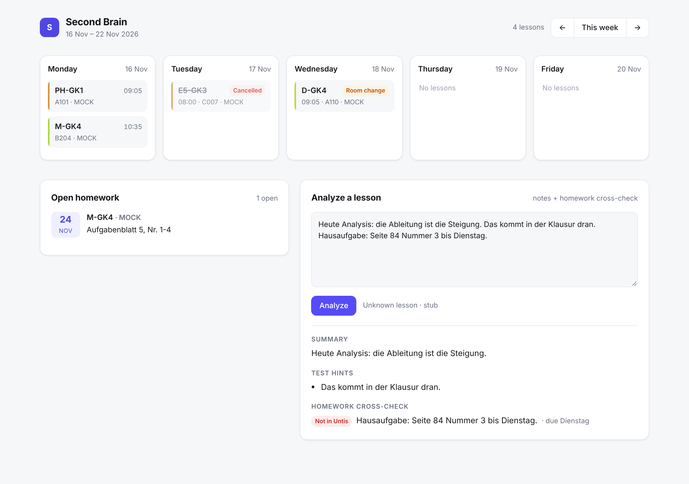

# Timetable-aware second brain for school

Loop: lesson -> notes -> tasks -> revision, driven by an agent that knows the WebUntis timetable.
See `docs/idea.md` for the pitch and `docs/structure.md` for the planned layout.

**Current direction:** a database of school materials (exams, worksheets, book pages, board photos) that students send in by photo to a **Telegram bot**, which an AI will later search and turn into answers and exam prep. Telegram is the product; the website is an optional extra. Lesson transcription is no longer the focus. `docs/idea.md` and `docs/structure.md` still describe the older transcription-first plan and haven't been updated yet.

## Progress



**Done**
- Idea and project structure documented (`docs/`).
- **Accounts** (`backend/app/auth.py`). In Telegram a person joins with an invite link and can connect a school (WebUntis) account with `/login`. On the website they sign in with the same school account. Either way the password is checked once with WebUntis and is never stored or logged, each person sees only their own schedule, homework and uploads, failed logins are rate-limited (per source, with a higher per-username limit so nobody can lock a classmate out), and website login is refused over plain HTTP except on localhost.
- Untis provider layer (`backend/app/untis/`): `real` and `mock` behind one interface, with timetable (rooms, cancellations, substitution notes), homework and `lesson_at(time)`.
- Terminal-style web page (`web/index.html`): login, the user's week schedule, open homework, photo upload (drop area, several photos, camera button on phones), the materials list with reading status, and a search box.
- **Photo uploads** from the web page and from a Telegram bot (`@untisianbot`). Photos are stored in `data/uploads/`, indexed in SQLite (`data/app.db`) with an owner, a Kurs and a kind (exam, worksheet, book, board, notes), and mirrored as Markdown notes into an Obsidian vault (`vault/`, optional, rebuildable from the DB).
- **Telegram bot** (`@untisianbot`, `backend/app/telegram_bot.py`), the main interface:
  - **Invite links:** an admin sends `/invite` and gets `https://t.me/<bot>?start=CODE`, with a use limit and a 14-day expiry (`/invites`, `/revoke`). Anyone else is told the bot is invite-only. Admins are the Telegram IDs in `ALLOWED_USERS`.
  - **Uploading:** send photos (best as a File, not a Photo), tap or type the Kurs (buttons come from the person's own timetable once they `/login`), tap the kind. Albums are handled as one batch. Limits: 20 photos at a time, 500 per person.
  - **Commands:** `/week`, `/today`, `/homework`, `/search`, `/list`, `/show 12` (the text of a photo), `/delete 12`, `/retry 12`, `/login`, `/logout`, `/cancel`, `/help`. They appear in Telegram's `/` menu, and admins also see the invite commands.
  - **Notifications:** when a photo has been read, the bot sends a message. Everything works only in private chats.
  - Website accounts can be connected with `/link CODE` (hidden from the menu).
- **Reading text from photos** (`backend/app/ocr/`): with `OCR_PROVIDER=gemini` a background worker sends each photo to the Gemini API (default `gemini-3.5-flash-lite`, about 1 s per photo in testing), stores the text, and makes it searchable (`/api/search`). Failed reads can be retried. Student name fields are blanked in the text on a best-effort basis.
- Agent core: send a lesson transcript to `/api/analyze` (login required) and get a structured note plus a homework cross-check against Untis. Runs behind a stub LLM for now (`LLM_PROVIDER=stub`), so it costs nothing; real models plug in via the `LLMClient` interface. No longer shown on the page.
- Offline tests in `backend/scripts/`: `test_bot_flow.py` (about 90 checks: migration, invites, accounts, `/login`, the commands, ownership, throttling, upload limits, the command menu) and `test_ocr.py` (worker, statuses, search, redaction).
- A security review of the password and account code found and fixed: the bot token appearing in logs, albums being handled one photo at a time, lockout abuse, a vault path-traversal case, and several limits.

**Known limits**
- **The Telegram bot works from anywhere** (it connects outward, so no tunnel is needed) **but only while the machine running it is on.** The website only listens on localhost; opening it to others would need an HTTPS tunnel (e.g. Cloudflare Tunnel), and its login refuses plain HTTP.
- **Collecting school passwords is a real risk** even though they are not stored. With `/login` the password passes through Telegram's servers (bot chats are not end-to-end encrypted) and sits in the chat until the bot deletes the message. The app also uses WebUntis's unofficial API. `/login` is optional and warns about this first; check with the school before opening the bot beyond a small trusted group.
- **Photo reading is opt-in and sends photos to Google.** Check your key's tier first (on the free tier Google may use content to improve its products). Name hiding only covers name fields like `Name: ...`; signatures, margins and names in the body are not caught, and the stored photo itself is unchanged.
- Schedule and homework are a snapshot taken when the user logs in; log in again to refresh.
- Student accounts can't read exams from Untis (`no right for getExams()`), so exam dates need another source.
- Subjects are raw course codes (e.g. `E5-GK3`), not readable names.
- The stub LLM is keyword-based, so real notes and answers need a real model (Gemini, Claude or a local one; only the stub exists).
- Run the bot on one machine at a time; Telegram allows a single polling connection per token.

**Next**
- Ask questions over the materials with citations, and generate exam prep from past exams
- A real LLM client behind `LLMClient` (Gemini text, or a local model on the desktop PC)
- Untis poller and Telegram alerts for Entfall, substitutions and new homework
- A share-with-my-Kurs switch (the `visibility` field exists; everything is private for now)
- Optional: an HTTPS tunnel if the website should be usable by others

## Run

```
python3 -m venv .venv
.venv/bin/pip install webuntis pydantic requests fastapi uvicorn python-multipart python-telegram-bot
cp .env.example .env        # fill in the Untis server/school (and optional Telegram and Gemini keys)
UNTIS_PROVIDER=real .venv/bin/uvicorn app.main:app --app-dir backend    # then open localhost:8000
```

`UNTIS_PROVIDER` must be set explicitly, otherwise login is disabled. `real` checks logins against WebUntis (`UNTIS_SERVER` and `UNTIS_SCHOOL` in `.env`). `mock` is a demo mode with fake data: any username with the password `demo`.

`backend/scripts/test_untis.py` checks the Untis login with the credentials in `.env`. Uploads go to `data/` and `vault/` (both gitignored).

**Telegram bot:** create a bot with @BotFather and put the token in `.env` as `TELEGRAM_TOKEN`. The bot starts together with the web app (`TELEGRAM_ENABLED=0` turns it off), and only one machine may run it at a time. To become an admin, message the bot `/whoami` and put the number it returns in `ALLOWED_USERS` (comma-separated for several), then restart. As an admin, send `/invite` and share the link with your classmates. `MAX_UPLOADS_PER_USER` (default 500) caps uploads per person.

**Photo reading (optional):** put `GEMINI_API_KEY` in `.env` and set `OCR_PROVIDER=gemini`. Photos uploaded before it was switched on are read at the next start. `GEMINI_MODEL` and `GEMINI_TIMEOUT` are optional.

**Tests** (use a scratch folder so they don't touch your data):

```
export DATA_DIR=/tmp/x/data VAULT_PATH=/tmp/x/vault
.venv/bin/python backend/scripts/test_bot_flow.py
.venv/bin/python backend/scripts/test_ocr.py
```
